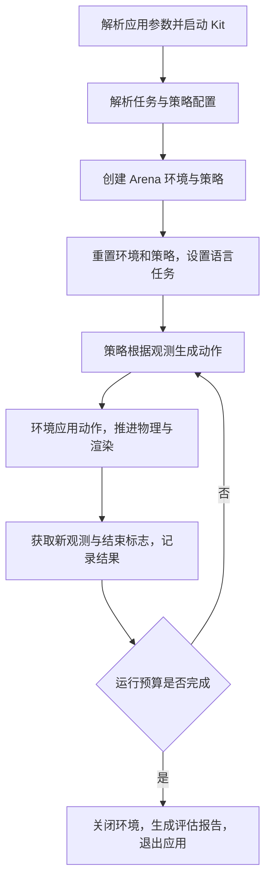

# Isaac GUI 入门与 policy_runner 管线

2026-10-11。依据本机固定的 Arena 提交 `8737b4ceb25f99f81a81786b7fde73139b52f324`、其 Isaac Lab / GR00T 子模块和本次运行日志核对。

当前使用容器入口，Isaac GUI 与无界面运行共用 `sim` 镜像。迁移前的 [驱动故障诊断](archive/ISAAC_DRIVER_DIAGNOSIS_2026-10-11.md) 与 [主机复核](archive/ENVIRONMENT_CHECK_2026-10-11.md) 已归档；安装历史与本轮精简状态见 [迁移记录](archive/CONTAINER_MIGRATION_2026-10-11.md)。

## 1. 先认识这几层

| 名称 | 在当前项目中的作用 |
|---|---|
| Isaac Sim / Kit | 应用窗口、USD 场景、PhysX 物理、RTX 渲染和传感器 |
| Isaac Lab | 用 Python 配置机器人、控制器、观测、动作和向量化环境 |
| Isaac Lab-Arena | 组合任务与环境，接入策略，记录 episode 和评估结果 |
| GR00T | 根据图像、机器人状态和语言指令预测动作；当前计划通过独立策略服务接入 |
| ROS 2 | 后续消息与设备集成；下面两个 GUI 教程不需要先启动 ROS |

当前项目全面容器化。先按 [容器指南](CONTAINERS.md) 构建或拉取镜像，以下命令在 Linux 主机终端调用 Docker，实际 Isaac 程序运行在 `sim` 容器内。不要在 `>>>` Python 提示符里输入。

## 2. 保留当前 Arena 场景窗口

Arena 已有官方交互入口 `environment_runner.py`。驱动检查通过后，在主机终端运行：

```bash
cd /home/channing/projects/robotics-lab
./scripts/lab sim-gui
```

它打开你之前运行的 `cube_goal_pose`：Franka 机械臂、桌面和方块。持续施加零动作并推进仿真，直到你关闭 Kit 窗口或按 Ctrl+C；任务结束仍可能触发环境自动重置，保留窗口不等于冻结最终状态。

这是官方场景检查入口，支持 **Shift + 鼠标左键拖动**物理对象。它使用 CPU PhysX、单环境，并关闭该会话的 episode 记录；CPU 物理仍然需要正常的 GPU 渲染驱动。源码见 [environment_runner.py](https://github.com/isaac-sim/IsaacLab-Arena/blob/8737b4ceb25f99f81a81786b7fde73139b52f324/isaaclab_arena/scripts/environment_runner.py#L109)。

| 入口 | 适合做什么 | 退出方式 |
|---|---|---|
| `environment_runner.py` | 持续查看场景、拖动物体、理解碰撞与重置 | 关闭窗口或 Ctrl+C |
| `policy_runner.py` | 执行指定策略，统计完整实验并生成报告 | 运行预算结束后收尾退出 |

### 从最简单的方块认识界面

驱动检查通过后，在主机终端运行：

```bash
cd /home/channing/projects/robotics-lab
./scripts/lab tutorial basic
```

许可证变量沿用此前本人已接受的同版许可。此教程创建地面、灯光和白色方块。源码的循环是 `while simulation_app.is_running(): sim.step()`，没有 20 或 1500 步的退出预算；正常情况下窗口持续保留到你关闭它。源码见 [launch_app.py](https://github.com/isaac-sim/IsaacLab/blob/af1bab4dc173ba69b08fab779c14ead61d13fd33/scripts/tutorials/00_sim/launch_app.py#L87)。

### 第一次只学四个区域

| 区域 | 你要观察的内容 |
|---|---|
| Viewport | 当前视角看到的三维场景 |
| Stage | USD 场景树；找到 `/World/Object`、地面和灯光 |
| Property | 选中对象的属性；先查看 Transform 中的位置、旋转和缩放 |
| 播放控制 | 暂停与继续物理仿真，观察暂停时仍可移动视角 |

USD 中的场景节点称为 **Prim**。机器人、关节、灯光、相机都可由不同类型的 Prim 表达；Stage 是它们的层次结构。Property 显示当前选择节点的属性。

### 用 10 分钟熟悉视角

1. 在 Stage 选择 `/World/Object`，鼠标移入 Viewport，按 **F** 将视角聚焦到它。
2. **Alt + 鼠标左键拖动**：围绕目标旋转视角。
3. **鼠标中键拖动**：平移视角；**滚轮**：靠近或远离。
4. 查看方块的位置与尺寸，再暂停、继续仿真。
5. 关闭窗口，确认终端进程正常退出。

界面布局可能因保存的工作区不同而变化。区域职责和操作参考 [Isaac Sim 6.0 界面说明](https://docs.isaacsim.omniverse.nvidia.com/6.0.0/gui/reference_user_interface.html) 与 [官方视角导航](https://docs.omniverse.nvidia.com/extensions/latest/ext_core/ext_viewport/navigation.html)。

**Viewport 的观察视角和策略输入的相机是两个概念。** 拖动观察视角通常不会改变机器人相机的安装位置，也不表示策略看到了这张画面。后续需要分别确认相机 Prim、观测配置和实际送给策略的图像。

## 3. 再看一个会动的机器人

关闭上一个教程后，在同一目录运行官方逆运动学教程，只创建一个环境：

```bash
./scripts/lab tutorial ik
```

这个教程让 Franka 机械臂在三个末端目标姿态之间循环，用阻尼最小二乘逆运动学计算关节目标。它同样持续运行到关闭窗口。首次运行可能需要获取机器人 USD 资产。

观察顺序：

1. 在 Stage 找到机器人，聚焦后观察各关节和末端。
2. 找到当前末端与目标的坐标轴标记：`/Visuals/ee_current`、`/Visuals/ee_goal`。
3. 看目标变化时，控制器如何让关节运动，末端逐渐接近目标。
4. 暂停后移动视角、查看关节节点，再继续运行。

这是确定性控制器演示，没有神经网络训练。源码见 [run_diff_ik.py](https://github.com/isaac-sim/IsaacLab/blob/af1bab4dc173ba69b08fab779c14ead61d13fd33/scripts/tutorials/05_controllers/run_diff_ik.py#L142)。先用它建立“末端目标 → 关节控制 → 物理运动”的直觉，再进入 G1 的全身控制。

## 4. policy_runner 到底做什么

**当前 policy_runner 是策略执行与评估入口。** 它负责把选定策略放进选定环境，反复获取动作并推进物理，最后汇总结果。



### 按源码顺序阅读

| 阶段 | 做的事情 | 源码入口 |
|---|---|---|
| 应用启动 | 先解析 AppLauncher 参数，进入 `SimulationAppContext`，启动 Kit | [policy_runner.py:152](https://github.com/isaac-sim/IsaacLab-Arena/blob/8737b4ceb25f99f81a81786b7fde73139b52f324/isaaclab_arena/evaluation/policy_runner.py#L152) |
| 配置解析 | 按 `policy_type` 找策略类，追加任务参数和策略专属参数，解析 Hydra 覆盖值 | [policy_runner.py:181](https://github.com/isaac-sim/IsaacLab-Arena/blob/8737b4ceb25f99f81a81786b7fde73139b52f324/isaaclab_arena/evaluation/policy_runner.py#L181) |
| 构建与记录 | Arena builder 创建 Gym 环境；创建时间戳输出目录和每个 episode 的 JSONL 记录 | [policy_runner.py:205](https://github.com/isaac-sim/IsaacLab-Arena/blob/8737b4ceb25f99f81a81786b7fde73139b52f324/isaaclab_arena/evaluation/policy_runner.py#L205) |
| 创建策略 | 从 CLI 配置构造策略；设置步数或 episode 预算，可选视频记录 | [policy_runner.py:221](https://github.com/isaac-sim/IsaacLab-Arena/blob/8737b4ceb25f99f81a81786b7fde73139b52f324/isaaclab_arena/evaluation/policy_runner.py#L221) |
| 初始化 rollout | `env.reset()`、`policy.reset()`，向策略传入任务语言描述 | [policy_runner.py:77](https://github.com/isaac-sim/IsaacLab-Arena/blob/8737b4ceb25f99f81a81786b7fde73139b52f324/isaaclab_arena/evaluation/policy_runner.py#L77) |
| 闭环执行 | `get_action(env, obs)` → `env.step(actions)` → 新观测；处理结束标志与策略状态重置 | [policy_runner.py:90](https://github.com/isaac-sim/IsaacLab-Arena/blob/8737b4ceb25f99f81a81786b7fde73139b52f324/isaaclab_arena/evaluation/policy_runner.py#L90) |
| 收尾 | 汇总指标、清理远程策略连接、关闭环境、生成 HTML 报告，退出应用上下文 | [policy_runner.py:244](https://github.com/isaac-sim/IsaacLab-Arena/blob/8737b4ceb25f99f81a81786b7fde73139b52f324/isaaclab_arena/evaluation/policy_runner.py#L244) |

策略若自带长度，例如轨迹回放，会优先使用该长度；其他策略需要指定 `--num_steps` 或 `--num_episodes`。进行可比较的任务评估时，应使用完整 episode 并记录实际完成数量。

### 一次 env.step 不等于一次渲染

Isaac Lab 的环境先处理动作，再在若干物理子步中施加控制、更新物理状态，按配置执行渲染；随后计算结束条件、奖励和观测。结束的环境在内部自动重置。runner 自己对这些环境重置的是策略状态，例如动作块缓存。

这次 `cube_goal_pose` 日志中，物理步长是 `1/120` 秒，控制 decimation 是 8，所以一次策略控制步推进 `8/120 = 1/15` 秒的仿真时间。1500 控制步约为 100 秒仿真时间，实际墙钟耗时还包含初始化、计算和收尾。

环境源码见 [ManagerBasedRLEnv.step](https://github.com/isaac-sim/IsaacLab/blob/af1bab4dc173ba69b08fab779c14ead61d13fd33/source/isaaclab/isaaclab/envs/manager_based_rl_env.py#L161)。`terminated` 表示任务定义的结束，可能是成功，也可能是失败；`truncated` 表示时间限制等截断。具体含义要查看所选任务配置，不能把所有结束都当成功。

### 你目前跑的是 zero_action

[ZeroActionPolicy](https://github.com/isaac-sim/IsaacLab-Arena/blob/8737b4ceb25f99f81a81786b7fde73139b52f324/isaaclab_arena/policy/zero_action_policy.py#L34) 每步返回全零动作。它用于检查环境链路，没有学到抓取技能，也没有接入 GR00T。

本次 1500 步日志记录了 1 个完成的 episode，成功率为 0，`object_moved_rate` 为 1。这个移动指标本身不能证明策略能力；重力、接触或初始化后的物体运动都需要结合画面和指标定义判断。20 步那次没有完成 episode，空样本的均值为 NaN，不能作为成功率实验结论。

以下是容器迁移前的历史报告；新运行结果放本仓库 `output/runs`：

- [本次 GUI 评估报告](/home/channing/data/runs/arena-groot/gui/2026-10-11_13-45-38/index.html)
- [之前 20 步评估报告](/home/channing/data/runs/arena-groot/basic/2026-10-11_13-25-40/index.html)

## 5. 它是 RLHF 吗？

**这条运行管线没有执行 RLHF，也没有执行策略训练。** 最直接的源码证据是：

```python
with torch.inference_mode():
    actions = policy.get_action(env, obs)
    obs, _, terminated, truncated, _ = env.step(actions)
```

这里使用推理模式；`env.step()` 返回的奖励在 runner 中被丢弃。这个入口没有损失计算、反向传播或优化器更新。日志出现 Reward Manager，是因为 Isaac Lab 使用通用的 RL 环境接口；环境可以计算奖励，不等于当前程序在用奖励训练策略。

| 流程 | 输入与目的 | 与当前项目的关系 |
|---|---|---|
| 推理 / 评估 | 已有策略根据观测输出动作，统计任务结果 | `policy_runner` 正在做的事 |
| 模仿学习 IL | 用示范中的观测与动作训练策略 | 官方 GR00T 工作流使用演示数据进行单独的微调 |
| 强化学习 RL | 用环境交互与奖励改进策略 | 需要另有训练算法与参数更新循环 |
| 人类反馈强化学习 RLHF | 利用人类评价或偏好改进策略；经典流程包含偏好奖励模型与后续策略优化 | 本次 runner 和官方所选 GR00T 微调流程没有这套环节 |

人类遥操作得到示范数据属于模仿学习的数据来源；“数据来自人”本身不能证明使用了 RLHF。经典 RLHF 的示范、偏好比较和强化学习步骤可参考 [InstructGPT 原始论文](https://arxiv.org/abs/2203.02155)。

本机官方训练说明见 [step_4_policy_training.rst](https://github.com/isaac-sim/IsaacLab-Arena/blob/8737b4ceb25f99f81a81786b7fde73139b52f324/docs/pages/example_workflows/locomanipulation/step_4_policy_training.rst)。它将示范数据转换成 LeRobot 格式，然后通过独立的 GR00T 微调入口训练；训练完成的 checkpoint 再由策略服务加载，供 runner 评估。

### 后续接 GR00T 时的闭环

```text
Arena 图像 + 机器人状态 + 语言任务
  → GR00T 客户端整理输入
  → 独立策略服务推理，返回一个动作块
  → 客户端按动作块调度与关节映射取出当前动作
  → 仿真 / 下层控制器执行
  → 新图像与状态，进入下一轮
```

返回动作块不意味着一次 `env.step()` 执行整个块；runner 每次获取当前动作并推进一个环境控制步。客户端源码见 [gr00t_remote_closedloop_policy.py](https://github.com/isaac-sim/IsaacLab-Arena/blob/8737b4ceb25f99f81a81786b7fde73139b52f324/isaaclab_arena_gr00t/policy/gr00t_remote_closedloop_policy.py)。GR00T 容器安装状态见 [迁移记录](archive/CONTAINER_MIGRATION_2026-10-11.md)；权重、数据和通信闭环在后续阶段准备，前述方块与 Franka 教程不依赖它们。

## 6. 接下来怎样开发

1. 用容器入口 `./scripts/lab sim-gui` 保留当前 Arena GUI；完成方块和 Franka 两个教程以熟悉界面与控制。
2. 在 Arena 的 `cube_goal_pose` 中理解机器人、物体、任务目标、动作和结束条件，再用 `policy_runner` 跑完整 episode。
3. 接入 G1 与官方 GR00T 权重，在 GUI 中观察闭环动作；保留视频、配置和结果。
4. 修改自己的实验代码后，先用一个 GUI 环境检查行为；需要重复统计时再用无窗口批量评估。

自己编写的模型、ROS、仿真代码分别放 `src/ai`、`src/ros`、`src/simulation`；当前实验组合放 `experiments/arena_g1`。上游教程用于学习与对照，保持固定版本；运行自有代码选对应容器，每个容器有自己的 Python 环境。

当前阶段的完成条件：你能打开并保留 GUI、操作视角、辨认场景与机器人节点，并能解释一次“观测 → 动作 → 物理 → 新观测”闭环。随后再推进 G1 策略复现。
