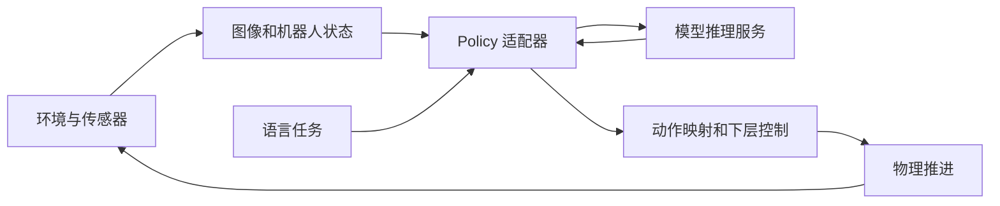

# 核心理论导读：从机器人闭环到 Arena × GR00T

2026-10-11。第一轮只建立系统结构与数据流的直觉，建议阅读 20–30 分钟，再按 [项目启动计划](PROJECT_START.md) 动手。

## 1. 机器人闭环的四件事

机器人系统反复执行：**观察 → 决策 → 执行 → 再观察**。

- **状态 state**：机器人和世界的实际情况，例如关节位置、速度、盒子姿态和接触情况。
- **观测 observation**：系统提供给策略的信息，例如相机图像和部分关节状态。观测可能看不到完整状态，也可能有噪声、遮挡与延迟。
- **动作 action**：策略要求下一步做什么。它可以是关节目标、末端位姿、速度命令或力矩。
- **环境 environment**：接收动作，推进物理，提供新观测和任务结果。

用符号表示：策略根据观测历史和任务指令生成动作 `a_t = π(o_≤t, L)`；控制器将动作转换为实际控制输入；物理系统产生下一时刻的状态。闭环会根据新观测修正后续行为。当前模型具体使用多少历史，由其配置决定。

**理解检查：** 相机没看到盒子背面，环境仍知道背面的几何形状吗？策略能够直接使用这些隐藏信息吗？请区分“仿真拥有的信息”和“策略实际输入的信息”。

## 2. 仿真器、学习框架与任务框架

| 层 | 回答的问题 | 当前组件 |
|---|---|---|
| 仿真 | 物体如何运动、碰撞？相机看到什么？ | Isaac Sim：PhysX、RTX、USD / Kit |
| 机器人环境 | 配什么机器人、观测、动作与控制器？怎样并行运行？ | Isaac Lab |
| 任务与评估 | 什么算成功、失败、超时？怎样组合场景和汇总实验？ | Isaac Lab-Arena |
| 策略执行 | 用哪个策略？运行多少步或 episode？如何记录？ | policy_runner |
| 模型接口 | 如何整理观测、调用模型、转换动作？ | Policy 适配器 |
| 模型 | 根据图像、状态和语言预测什么动作？ | GR00T 或自己的算法 |

ROS 2 提供消息与设备集成能力；本轮官方基础场景通过 Python 环境接口运行。Docker 封装当前项目的 ROS、仿真与模型环境；三个镜像共同构成容器管线，见 [容器指南](CONTAINERS.md)。

**理解检查：** 换自己的神经网络，通常首先改变哪一层？给场景增加相机，又会改变哪些层？

## 3. 几何、关节与控制

**位姿 pose**由位置与朝向组成。位置向量必须说明参考坐标系；相同的 `(x, y, z)` 在世界坐标系和机器人基座坐标系中代表不同地点。角度还要区分弧度与度，以及欧拉角和四元数的表示约定。

机械臂有两种常见目标：

- **关节空间目标**：每个关节转到指定角度。
- **末端空间目标**：夹爪到达指定位置与朝向。逆运动学 IK 将末端目标转换为关节目标；目标未必可达，解也未必唯一。

控制器让机器人跟踪目标。例如关节位置控制根据误差产生控制输入；G1 的下层控制还要协调站立、行走和平衡。策略输出的动作经控制器执行后，才成为物理运动。

当前 G1 工作流：GR00T 输出上半身关节目标、基座高度和导航命令；WBC 承担下层控制，其中下半身使用 RL 策略。`g1_wbc_pink` 的上肢接口包含末端 IK，`g1_wbc_joint` 接收关节目标，因此二者不能仅凭动作长度随意互换。

**理解检查：** 向关节位置接口传入力矩向量，即使长度相同，为什么仍然错误？

## 4. 三种时钟

- **物理步长**：一次物理计算推进多少仿真秒。
- **控制步长**：隔多少物理步更新一次策略动作。若 decimation 为 `d`，则 `控制步长 = d × 物理步长`。
- **渲染与推理频率**：画面刷新、相机采样、模型推理可以有各自频率。

另外还有墙钟时间，即真实等待时间。仿真可以快于或慢于真实时间。

`cube_goal_pose` 此前日志为物理步长 `1/120` 秒、decimation 8，因此控制频率为 15 Hz。G1 工作流要求 50 Hz 控制，两者应分别读取配置。

G1 当前配置预测并执行 50 个控制动作。50 Hz 下这个动作块覆盖 1 秒仿真时间；执行时逐个取出动作，不会在一个 `env.step()` 内执行整个块。动作块内部仍有物理与控制更新，但模型重新获取观测的频率取决于调度配置。

**理解检查：** 模型预测一段未来动作，可以减少哪些开销？在环境突然变化时又有什么代价？

## 5. episode、结束、奖励与指标

一次 **episode** 是从初始化开始，到任务结束或截断的一段尝试。

- `reset()`：初始化环境，得到初始观测。
- `step(action)`：推进环境，返回观测、奖励、结束标志等。
- `terminated`：任务定义的结束，可以是成功或失败。
- `truncated`：时间限制等截断，具体要看任务配置。

当前 Isaac Lab 环境内部会自动重置已结束的环境；策略也需要清理它为该 episode 保存的历史或缓存。

**奖励 reward**用于表达训练信号，**评估指标 metric**用于说明实验结果。成功率、超时率、完成时间都属于评估指标。Reward Manager 出现在日志中，并不表示调用方正在训练模型；当前 policy_runner 处于推理模式，丢弃返回的奖励。

G1 的放置成功检查组合了几何位置、目标对物体的向上支撑接触和较低的物体速度。判断依据是任务代码；截图中“看起来进箱子了”还需要与实际结果核对。

**理解检查：** 只跑 20 步、没有结束任何 episode，能否评估成功率？一个成功 episode 能否证明稳定成功？

## 6. 模型学习与模型运行

训练从数据或交互中更新参数，生成 checkpoint；推理加载参数并产生输出；评估检查输出在任务中的效果。这三个阶段可以使用不同进程与软件环境。

| 方法 | 学习依据 | 本项目中的位置 |
|---|---|---|
| 模仿学习 IL | 示范中的观测与动作关系，具体损失由模型决定 | GR00T 的任务微调 |
| 强化学习 RL | 环境交互与奖励 | G1 下层控制策略的训练来源 |
| RLHF | 人类评价或偏好用于奖励与策略优化 | 当前所选任务微调和 runner 不包含该流程 |

当前 `zero_action` 没有神经网络，每步返回零动作。官方 Franka IK 教程使用确定性控制。二者同样可以构成观测、控制与物理运行链路。

GR00T 是 VLA 模型：Vision、Language、Action 表示输入与输出的模态关系。在当前任务中，它接收图像、机器人状态和语言任务，输出动作块。网络架构、具体训练损失与优化器留到模型学习阶段再展开。

**理解检查：** policy_runner 能否运行自己用不同框架训练的模型？为什么训练方法变化通常不要求重写物理环境？

## 7. 本项目的数据流与可复现性

policy_runner 组织这个闭环的生命周期与记录。自己的模型通常通过自定义 Policy 接入；特殊训练或异步执行流程可另写 runner，并复用环境。

为了比较实验，需要保存代码提交、权重版本、配置、随机种子、设备、运行预算与实际完成 episode 数。固定种子有助于复现，但 GPU 并行和浮点计算等因素可能仍引入差异。

**第一轮学习目标：** 能用自己的话描述每层职责、一次闭环、一次 episode，以及“训练、推理、评估”的区别。具体模型推导将在基线运行后安排。

## 源码依据

- [Policy 接口](https://github.com/isaac-sim/IsaacLab-Arena/blob/8737b4ceb25f99f81a81786b7fde73139b52f324/isaaclab_arena/policy/policy_base.py)
- [rollout 循环](https://github.com/isaac-sim/IsaacLab-Arena/blob/8737b4ceb25f99f81a81786b7fde73139b52f324/isaaclab_arena/evaluation/policy_runner.py#L66)
- [环境物理执行](https://github.com/isaac-sim/IsaacLab/blob/af1bab4dc173ba69b08fab779c14ead61d13fd33/source/isaaclab/isaaclab/envs/manager_based_rl_env.py#L161)
- [G1 场景与 50 Hz 控制配置](https://github.com/isaac-sim/IsaacLab-Arena/blob/8737b4ceb25f99f81a81786b7fde73139b52f324/isaaclab_arena_environments/galileo_g1_locomanip_pick_and_place_environment.py)
- [G1 模态配置](https://github.com/isaac-sim/IsaacLab-Arena/blob/8737b4ceb25f99f81a81786b7fde73139b52f324/isaaclab_arena_gr00t/embodiments/g1/g1_sim_wbc_data_config.py)
- [G1 下层控制接口](https://github.com/isaac-sim/IsaacLab-Arena/blob/8737b4ceb25f99f81a81786b7fde73139b52f324/isaaclab_arena_g1/g1_env/mdp/actions/g1_decoupled_wbc_joint_action.py#L39)
- [放置成功判断](https://github.com/isaac-sim/IsaacLab-Arena/blob/8737b4ceb25f99f81a81786b7fde73139b52f324/isaaclab_arena/tasks/predicates/object_on_destination_term.py)
