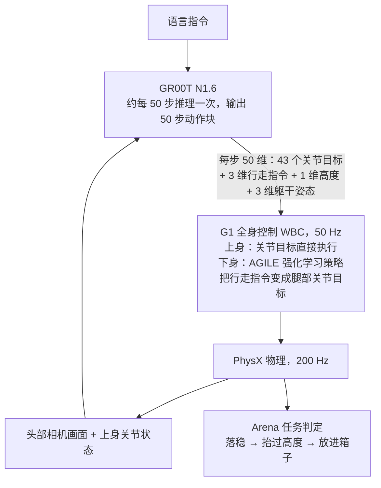

# G1 Demo 学习计划

2026-10-13。官方 G1 demo 已在本机跑通（[运行记录](CONTAINERS.md#5-rl-训练与模型服务)、[路线图](ROADMAP.md)第 1 步）。本页先用一页讲清这个 demo 的宏观思想，再按天安排从零开始的学习：Day 0 是 10 月 13 日的收口与入门，Day 1–5 学 demo 和框架工具，最后是数据与训练的扩展，以及以后设计新架构、新算法时的切入点。2026-10-19 起，每天按最小闭环、至少看完、选做三档安排，并标明建议用时。

文中的上游文件都来自固定提交 `8737b4c`，可以在 GitHub 上看，也可以在 sim 容器里打开 `/opt/arena/` 下的同名文件（VS Code 的 sim 窗口用 **File: Open File...**）。

## 一、宏观图景

### 一句话

G1 人形机器人站在仿真仓库里，看着头部相机画面、拿着一句语言指令。大模型 GR00T 决定双臂、双手、腰部往哪动，以及身体往哪走；一个用强化学习训练的小网络（WBC 下身策略）负责迈腿和保持平衡；物理引擎让这一切真实发生；Arena 负责搭场景、跑实验、判定成败。

### 分层与时间尺度



| 层 | 频率 | 做什么 | 在哪里 |
|---|---|---|---|
| GR00T N1.6 | 每 50 个控制步（1 秒）推理一次 | 看图像、读状态和指令，输出未来 50 步的动作 | `policy` 容器，经 ZMQ 提供服务 |
| WBC | 50 Hz（控制步） | 上身关节目标直接下发；下身由 AGILE 策略根据行走速度和高度指令生成腿部动作，保持平衡 | `sim` 容器，Arena 的 G1 动作项 |
| PhysX | 200 Hz（dt = 1/200，每个控制步 4 个物理步） | 计算碰撞、接触、关节动力学 | `sim` 容器，Isaac Sim |
| 任务判定 | 每个控制步 | 依次检查：物体落稳、盒子被抬过高度、盒子在箱内且接触力大于 0.5 N、速度低于 0.1 | Arena 任务与谓词 |

一个 episode 最长 30 秒仿真时间，即 1500 个控制步。10 月 13 日成功的那次在第 979 步完成放置。

### 三种"学习"，和一个"不学习"

- **GR00T 预训练**：NVIDIA 用大量多种机器人的数据，加上一个视觉语言模型（Cosmos-Reason-2B 的变体），训练出通用的 VLA（视觉-语言-动作）模型。动作头是 32 层的扩散 Transformer（DiT），通过逐步去噪生成连续动作。
- **任务微调（模仿学习）**：在"从货架取盒子放进箱子"这个任务的示范数据上继续训练，得到我们下载的 `GN1x-Tuned-Arena-G1-Loco-Manipulation`。示范数据来自少量遥操作，再用 Isaac Lab Mimic 自动扩增。
- **WBC 下身（强化学习）**：走路和平衡的策略在仿真里用强化学习训练好，以 ONNX 文件形式提供。
- **评估不学习**：我们跑的 `policy_runner` 只做推理和打分，模型参数不变。奖励值即使出现在日志里，也没有被用来训练。

### 官方完整工作流

Arena 的 G1 教程分五步：环境准备 → 遥操作采集示范 → Mimic 生成大量数据 → GR00T 微调 → 闭环评估。我们直接用了官方微调好的权重，只做了第五步。前四步会在扩展阶段学习。

### 为什么这样分层

大模型通用但慢，适合低频地"想好接下来一秒怎么做"；平衡和步态要求快速反应，交给高频的小型强化学习策略；物理计算更快、更细。这种"慢规划、快反射"的分层，是以后设计新架构时最先要想清楚的地方：每一层输出什么、多快、用什么接口交给下一层。路线图第 2 步的接口契约，讨论的就是这些。

## 二、日程总览

每天分三档：**最小闭环**是当天必须亲手完成的部分，通常是"先预测，再运行，再核对"，做完就算这一天完成；**至少看完**是必读材料；**选做**留给有余力的时候。用时按第一次接触估算。每天开始前，我先在本机复核当天要用的命令。

| 天 | 主题 | 最小闭环 | 必做用时 | 选做用时 |
|---|---|---|---|---|
| Day 0 | 收口与入门：读懂 10 月 13 日的运行结果 | 在评估记录里找到三个判定事件 | 约 1 小时 | 无 |
| Day 1 | 仿真基础：Isaac Sim 与 Isaac Lab 的世界观 | 运行并改动一个 60 行的"感知、决策、执行、物理"循环 | 约 1 小时 15 分钟 | 约 45 分钟 |
| Day 2 | Arena：场景 + 机器人 + 任务 = 环境，评估与指标 | 用零策略跑一个 episode，读懂报告 | 约 1 小时 30 分钟 | 约 40 分钟 |
| Day 3 | G1 与全身控制：关节空间、50 维动作、WBC | 给 G1 零动作，预测并观察它的姿态 | 约 1 小时 30 分钟 | 约 30 分钟 |
| Day 4 | GR00T：VLA 的输入输出、动作块、服务端与客户端 | 启动推理服务并 ping 通，记录显存 | 约 1 小时 30 分钟 | 约 45 分钟 |
| Day 5 | 完整闭环复盘与小实验 | 跑一个无界面 episode，读事件时间线 | 约 1 小时 30 分钟 | 约 45 分钟 |
| 扩展 | 数据与训练流水线、云端算力 | 开始前先讨论 | 按需 | 按需 |

本机显存 12 GB：GR00T 推理约占 6.2 GB，无界面闭环评估峰值约 10.7 GB。因此带 GR00T 的闭环先用无界面方式运行，由我根据判定记录讲解过程；只看场景、不跑 GR00T 时可以放心开 GUI。

每天结束时，把"理解检查"的回答用几句话写下来，发给我核对；值得留存的内容我整理进文档。

`output/` 下的文件在主机上直接打开即可；在 VS Code 的容器窗口里，它们也出现在资源管理器的 `output/` 下，命令行里则用 `/runs`、`/data` 这样的短路径。

## 三、每日安排

### Day 0：收口与入门，约 1 小时

**目标**：能说出 demo 由哪几层组成、10 月 13 日两次运行各发生了什么。

1. 读完本页第一部分"宏观图景"。（15 分钟）
2. 在主机浏览器打开成功那次的报告 `output/runs/arena-g1/evaluation/2026-10-13_06-38-43/index.html`，再看同目录下的 `episode_results_rank0.jsonl`。找到三个事件：第 1 步物体落稳、第 136 步盒子抬过高度、第 979 步放置成功。再看失败那次 `2026-10-13_06-17-27/episode_results_rank0.jsonl`：它在第 75 步就抬起了盒子，但直到第 1500 步都没放进箱子。（15 分钟）
3. 粗读两份配置，不求全懂，只找关键字段（20 分钟）：
   - [GR00T 闭环配置](https://github.com/isaac-sim/IsaacLab-Arena/blob/8737b4ceb25f99f81a81786b7fde73139b52f324/isaaclab_arena_gr00t/policy/config/g1_locomanip_gr00t_closedloop_config.yaml)：语言指令、`action_horizon: 50`、相机名 `robot_head_cam_rgb`。
   - [G1 模态配置](https://github.com/isaac-sim/IsaacLab-Arena/blob/8737b4ceb25f99f81a81786b7fde73139b52f324/isaaclab_arena_gr00t/embodiments/g1/g1_sim_wbc_data_config.py)：输入是 `ego_view` 图像和左右臂、左右手、腰五组关节状态；输出是这五组关节加上 `base_height_command`、`navigate_command`，每次 50 步（`delta_indices` 为 0–49）。
4. 理解检查（10 分钟）：
   - 979 步是多少秒仿真时间？这段时间里 GR00T 大约推理了多少次？
   - 失败那次已经把盒子抬起来了，说明哪些环节是正常的？问题更可能出在哪一层？
   - GR00T 的输出里为什么没有腿部关节？

### Day 1：仿真基础

**目标**：理解"场景、物理步、控制循环"，亲手跑通并改动一个最小闭环。

**最小闭环（必做，约 45 分钟）**：一个方块被比例控制器推向目标点。

1. 在 VS Code 的 sim 窗口打开 `output/runs/setup/2026-10-12/verification/minimal_closed_loop.py`（约 60 行，命令行路径是 `/runs/setup/2026-10-12/verification/minimal_closed_loop.py`）。在 `for step in range(args.steps)` 循环里找出四行：感知（读 `root_pos_w`）、决策（`gain * error`）、执行（`write_root_velocity_to_sim_index`）、物理（`sim.step()`）。（15 分钟）
2. 在主机终端运行，Kit 启动约需 1 分钟（10 分钟）：

   ```bash
   ./scripts/lab sim python /runs/setup/2026-10-12/verification/minimal_closed_loop.py --headless --device cpu
   ```

   终端每 100 步打印一行位置和误差，最后一行应为 `final_error_m` 约 0.0044（4.4 mm）、`"passed": true`。在 sim 窗口的终端里也可以直接运行 `python /runs/...`，参数相同。
3. 把 `gain, dt = 10.0, ...` 中的 10.0 改成 2.0。**先写下你预测的最终误差**，再运行同一条命令。这次 `"passed": false`、退出码为 1 是预期结果。核对后把增益改回 10.0。（20 分钟）

**至少看完（约 30 分钟）**：[核心理论](CORE_CONCEPTS.md) 第 1–4 节：闭环四件事、仿真与框架的分层、几何与控制、三种时钟。读第 4 节时对照脚本：`dt=0.01`，每个物理步都更新一次指令。

**选做（约 45 分钟）**：

- `./scripts/lab tutorial basic`，按 [Isaac GUI 入门](ISAAC_GUI_AND_POLICY_RUNNER.md#从最简单的方块认识界面)练习：Stage 里找到 `/World/Object`，按 F 聚焦，Alt + 左键旋转、中键平移、滚轮缩放，在 Property 查看位置和尺寸，暂停、继续，再关闭窗口。（20 分钟）Day 3 要在 Stage 里找 G1 和场景物体，届时还没做的话先补上这一项。
- `./scripts/lab tutorial ik`，按 [再看一个会动的机器人](ISAAC_GUI_AND_POLICY_RUNNER.md#3-再看一个会动的机器人)观察"末端目标 → IK → 关节目标 → 物理运动"。（25 分钟）

**概念**：USD 场景与 Prim、`SimulationContext`、刚体与关节体（Articulation）、物理步长与控制步长（decimation）。

**理解检查**：

- 循环里哪一行是感知、决策、执行、物理？如果删掉 `sim.step()`，会发生什么？
- 增益改成 2 后，方块停在离目标多远的地方？为什么不是 0？（提示：代码注释里的 `mu*g*dt`。）误差和增益是什么关系？
- 这个脚本的物理步长和控制步长各是多少？G1 是 200 Hz 物理、50 Hz 控制，两者差在哪里？
- （做了选做的话）IK 教程里有没有神经网络？

### Day 2：Arena 与评估

**目标**：知道一个 Arena 环境由什么拼成，评估怎样运行、怎样判定成败。

**最小闭环（必做，约 40 分钟）**：

1. 先预测：每一步都给零动作，`cube_goal_pose` 任务会成功吗？episode 会在什么时候结束？
2. `./scripts/lab evaluate`：用零策略跑完一个 episode（带窗口）。报告写在 `output/runs/learning/evaluation/` 下最新的目录里。
3. 打开报告，找出 episode 长度、是否成功、各项指标；再对照日志，区分奖励（reward）和评估指标（metric）。

**至少看完（约 45 分钟）**：

- [Policy 接口](https://github.com/isaac-sim/IsaacLab-Arena/blob/8737b4ceb25f99f81a81786b7fde73139b52f324/isaaclab_arena/policy/policy_base.py)与 [rollout 循环](https://github.com/isaac-sim/IsaacLab-Arena/blob/8737b4ceb25f99f81a81786b7fde73139b52f324/isaaclab_arena/evaluation/policy_runner.py#L66)：和 Day 1 的循环对照，看"感知、决策、执行、物理"各自搬到了哪里。
- [任务](https://github.com/isaac-sim/IsaacLab-Arena/blob/8737b4ceb25f99f81a81786b7fde73139b52f324/isaaclab_arena/tasks/pick_and_place_task.py)与[放置判定](https://github.com/isaac-sim/IsaacLab-Arena/blob/8737b4ceb25f99f81a81786b7fde73139b52f324/isaaclab_arena/tasks/predicates/object_on_destination_term.py)。

**选做（约 40 分钟）**：

- `./scripts/lab sim-gui`：在 `cube_goal_pose` 场景里用 Shift + 左键拖动物体，观察接触、重力和环境自动重置。（20 分钟）
- [G1 环境定义](https://github.com/isaac-sim/IsaacLab-Arena/blob/8737b4ceb25f99f81a81786b7fde73139b52f324/isaaclab_arena_environments/galileo_g1_locomanip_pick_and_place_environment.py)：背景、物体、目标箱、机器人、任务如何组合成一个环境；`set_control_rate_50hz` 在哪里。（20 分钟）

**理解检查**：环境、任务、Policy、policy_runner 各自负责什么？为什么 policy_runner 运行时模型不会被训练？"盒子放进箱子"在代码里具体由哪几个条件判定？

### Day 3：G1 与全身控制

**目标**：理解 50 维动作的含义，以及 GR00T 和 WBC 怎样分工。

**最小闭环（必做，约 40 分钟）**：不启动 GR00T，只给 G1 持续的零动作。

1. 先预测：关节目标全为 0、行走指令为 0 时，机器人会保持站立、蹲下还是摔倒？
2. 运行：

   ```bash
   ./scripts/lab sim-gui python isaaclab_arena/scripts/environment_runner.py \
     --viz kit --device cpu --num_envs 1 galileo_g1_locomanip_pick_and_place --embodiment g1_wbc_joint
   ```

3. 观察姿态并核对预测；在 Stage 中找到机器人、货架、盒子和箱子。

**至少看完（约 45 分钟）**：

- [关节目标型 WBC 动作项](https://github.com/isaac-sim/IsaacLab-Arena/blob/8737b4ceb25f99f81a81786b7fde73139b52f324/isaaclab_arena_g1/g1_env/mdp/actions/g1_decoupled_wbc_joint_action.py#L39)：`action_dim` = 43 + 3 + 1 + 3；上身关节直接位置控制，下身用 AGILE 策略。
- `isaaclab_arena_gr00t/embodiments/g1/43dof_joint_space.yaml`（sim 容器 `/opt/arena/` 下）：43 个关节的名字和顺序。

**选做（约 30 分钟）**：[G1 机器人定义](https://github.com/isaac-sim/IsaacLab-Arena/blob/8737b4ceb25f99f81a81786b7fde73139b52f324/isaaclab_arena/embodiments/g1/g1.py)，找到 `g1_wbc_joint` 与 `g1_wbc_pink` 两种动作配置并比较。

**理解检查**：零动作下 G1 为什么是你看到的那个姿态？为什么腿部交给强化学习策略，而不是让 GR00T 直接输出？`g1_wbc_pink` 的上身接收末端位姿、经 IK 转成关节目标，`g1_wbc_joint` 直接接收关节目标，两者为什么不能仅凭动作长度互换？

### Day 4：GR00T

**目标**：说清 VLA 的输入、输出和推理方式，理解动作块的利弊。

**最小闭环（必做，约 40 分钟）**：

1. `./scripts/lab policy-server` 启动服务，读日志里的模型加载过程和 DiT 参数量。
2. 另开终端运行 `./scripts/lab policy-ping` 和 `nvidia-smi`，记录服务空闲时的显存占用。

**至少看完（约 45 分钟）**：[远程闭环 Policy](https://github.com/isaac-sim/IsaacLab-Arena/blob/8737b4ceb25f99f81a81786b7fde73139b52f324/isaaclab_arena_gr00t/policy/gr00t_remote_closedloop_policy.py)：怎样整理观测、请求动作块、逐步取出动作。读完画出一次请求的数据流：仿真观测 → 客户端整理 → ZMQ → 服务端推理 → 50 步动作 → 逐步执行。

**选做（约 45 分钟）**：

- Isaac-GR00T 的 [README](https://github.com/NVIDIA/Isaac-GR00T/blob/e29d8fc50b0e4745120ae3fb72447986fe638aa6/README.md)：模型结构（视觉语言模型 + 扩散 Transformer 动作头）和 N1.6 的变化。
- 权重目录（`output/storage/models/arena-g1/checkpoint-20000`）里的 `statistics.json` 与 `experiment_cfg/`：动作和状态的归一化统计、训练配置。

**理解检查**：动作块可以减少哪些开销？环境突然变化时又有什么代价？"Embodiment tag"和归一化统计为什么必须与训练时一致？换成你自己训练的模型，需要改哪几处？

### Day 5：完整闭环复盘与小实验

**目标**：把各层串起来，学会用实验而不是单次运行下结论。

**最小闭环（必做，操作约 30 分钟，另需等待约 12 分钟）**：先启动推理服务，再按[容器指南](CONTAINERS.md#5-rl-训练与模型服务)的无界面方式跑一个 episode（也可以由我代为运行）；在 `episode_results_rank0.jsonl` 里读出事件时间线，和 Day 0 的两次运行比较。

**至少完成（约 1 小时）**：用自己的话写约一页总结：一次完整闭环的数据流、各层频率、成功判定、三次运行的差异。

**选做（约 45 分钟，含一次等待）**：只改一个变量再跑一次，例如 `--seed`，或者用 `--language_instruction` 改写指令的措辞。先预测结果，再比较事件时间线。

**理解检查**：一成一败能说明成功率吗？要得到有意义的成功率，需要多少次运行、固定哪些条件？在云端怎样并行跑？

### 扩展：数据与训练流水线

基线理解之后，按官方教程的前四步学习数据与训练：下载小数据集并回放；理解遥操作采集和 Mimic 扩增；把 HDF5 转成 LeRobot 格式（在 `sim` 中）；了解 GR00T 微调配方（官方用 8 张 GPU、批大小 96、20000 步，需要云端算力）；最后用评估流程比较自己微调的模型。这部分涉及数据和训练方案，开始前先一起讨论再确定。

## 四、之后设计新架构与算法的切入点

学完以上内容，你会看到这个 demo 里可以替换或扩展的位置。每一处在动手前都先讨论技术路线：

| 切入点 | 能做什么 | 对应的上游位置 |
|---|---|---|
| Policy | 换成自己的模型或算法，接入同一套评估 | `isaaclab_arena/policy/policy_base.py` |
| 动作接口 | 改变高层输出的形式，例如末端位姿或速度指令 | G1 的 WBC 动作项 |
| 任务与判定 | 新任务、新的成功条件和指标 | `isaaclab_arena/tasks/` |
| 数据 | 新的示范来源、扩增方式、数据格式 | Mimic、LeRobot 转换 |
| 分层结构 | 重新划分"慢规划 / 快反射"，或加入 ROS、控制核心 | [路线图](ROADMAP.md)第 2–5 步 |
