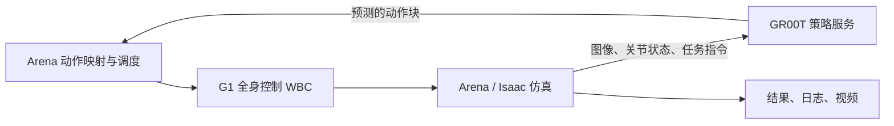

# 路线图

2026-10-11 确定，执行到每一步前再按当时情况调整。阶段划分来自 [骨架审查](archive/SKELETON_REVIEW_2026-10-11.md)，用户已认可。

## 现状

三个镜像与启动入口已就绪：`dev`（ROS 2 Jazzy、RViz、C++）、`sim`（Isaac Sim / Lab / Arena）、`policy`（GR00T N1.6）。`src/ai`、`src/ros`、`src/simulation` 目前只有职责说明，没有自研代码。

能运行的闭环只有上游 Arena × GR00T 回路。官方 G1 权重已下载，2026-10-13 首次跑通闭环评估：两个无界面 episode 中一个在第 979 步成功放置，一个抬起盒子但 1500 步内未放入箱子（运行记录在 `output/runs/arena-g1/`）。样本太少，还不能作为成功率结论：

`A`、`W`、`S` 在 `sim` 容器的同一进程内；`G` 在 `policy` 容器，经 ZMQ（`127.0.0.1:5555`）连接。

## 推进顺序

每一步都在上一步可运行的基础上增加一层，避免同时引入 ROS、控制与真机三类不确定性。

1. **跑通上游基线回路。** 下载 `nvidia/GN1x-Tuned-Arena-G1-Loco-Manipulation`（revision `gn1_6`），运行 `policy-server` 与 `g1-evaluate`，记录成功率、episode 数、推理延迟和显存峰值。本机 GPU 为 12 GB，带相机的仿真与 GR00T 3B 同卡运行可能不够；不够时把 `policy` 放到远程 GPU，评估端已支持 `--remote_host`。
2. **写接口契约。** 在 `docs/` 写清楚：43 自由度关节顺序（上游 `isaaclab_arena_gr00t/embodiments/g1/43dof_joint_space.yaml`）、单位与坐标系、50 Hz 控制与 50 步动作块、时间戳与 `use_sim_time`、超时与失效语义。先有文档，再写适配代码。同时确定各话题的 QoS 与传输方式：当前全部走 UDPv4；传图像、点云等大数据时，先用 `ros2 topic hz` / `bw` 测量，再考虑给 `dev` 加 `ipc: host` 并启用 Fast DDS 共享内存，或用同进程组合节点实现零拷贝。
3. **ROS 作为旁路观察者。** Isaac 的 ROS 2 bridge 发布 `/clock`、`/joint_states`、`/tf` 与头部相机，`dev` 中用 RViz 查看、用 rosbag 记录到 `/runs`。不改变回路时序。优先用标准消息；自定义消息需要在 `dev` 构建后，再让 `sim` 中 Isaac 自带的 ROS 库加载，链路更长。
4. **ROS 进入回路（部署形态）。** 策略输出改走 ROS 话题，引入真实的异步与延迟，与第 1 步指标对比，量化通信带来的损失。RL 训练的内层循环始终不经过 ROS。
5. **真机与控制核心。** 接入真机时编写控制核心，以动态库形式提供给其他层调用：
   - 核心是不依赖 ROS、Isaac 与模型 SDK 的 C++ 库，届时在 `src/` 下新建模块；
   - 仿真中由 `sim` 进程直接加载，保证训练与评估的确定性；ROS 节点与真机进程链接同一个库；
   - Unitree G1 的底层接口是 `unitree_sdk2`（基于 Cyclone DDS 的 `LowCmd` / `LowState`）或 `unitree_ros2`（要求 `rmw_cyclonedds_cpp`）。RMW 已可在 `.env` 切换，`dev` 届时加装 `ros-jazzy-rmw-cyclonedds-cpp`；
   - G1 开发版机载计算单元是 aarch64 的 Jetson Orin（接入前核实型号），相关镜像届时需要多架构构建。

**并行的研究线**：按上游流程，在 `sim` 中生成或下载示范数据并转换为 LeRobot 格式，在 `policy` 中微调 GR00T（可使用发布的镜像在云端 GPU 上运行），再用第 1 步的评估流程比较结果。

## 已定的长期决定

| 日期 | 决定 |
|---|---|
| 2026-10-11 | 全部框架在容器中运行；镜像为 `dev`、`sim`、`policy` 三个，主机原生框架不参与项目 |
| 2026-10-11 | `src/` 只放项目开发源码，每个子目录是独立模块；`cppsrc/`、`pythonsrc/`、`rossrc/` 是顶层学习沙盒 |
| 2026-10-11 | Python 包只通过 Dockerfile 与锁文件进入镜像；新增依赖先讨论安装方式，不在终端 `pip install` |
| 2026-10-11 | 控制核心推迟到真机阶段，以动态库形式供其他层调用；此前不保留 `src/control` 占位 |
| 2026-10-11 | 测试与 CI 在全栈打通后再配置 |
| 2026-10-11 | `sim`、`policy` 使用 `ipc: host`，满足 dataloader 与分布式训练的共享内存需求 |
| 2026-10-18 | 仓库分两层：根目录放 Git、编排与基础设施，只在主机使用；开发工作区在 `ws/`，每个容器只挂载自己的目录，协作交给编排器；Git 只在主机上操作 |

## 暂缓的工程项

- 测试与 CI：全栈打通后，按模块分别建立 `sim` / `policy` 内的 pytest、`dev` 内的 `colcon test`、控制核心的 CTest。
- 在共享网络上限制 ROS 发现范围（Jazzy 的 `ROS_AUTOMATIC_DISCOVERY_RANGE=LOCALHOST`），需在第 3 步复测 `sim` ↔ `dev` 桥接后再设为默认。
