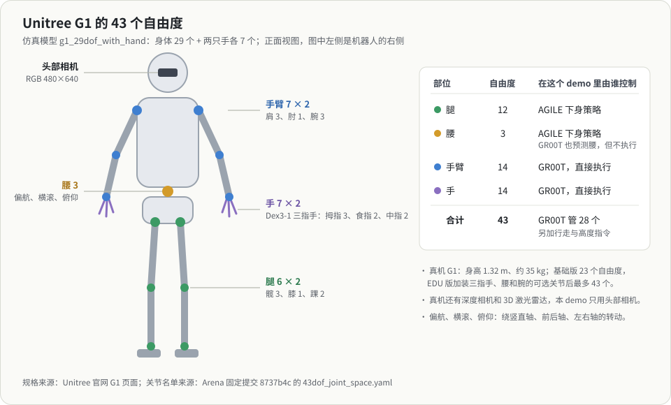
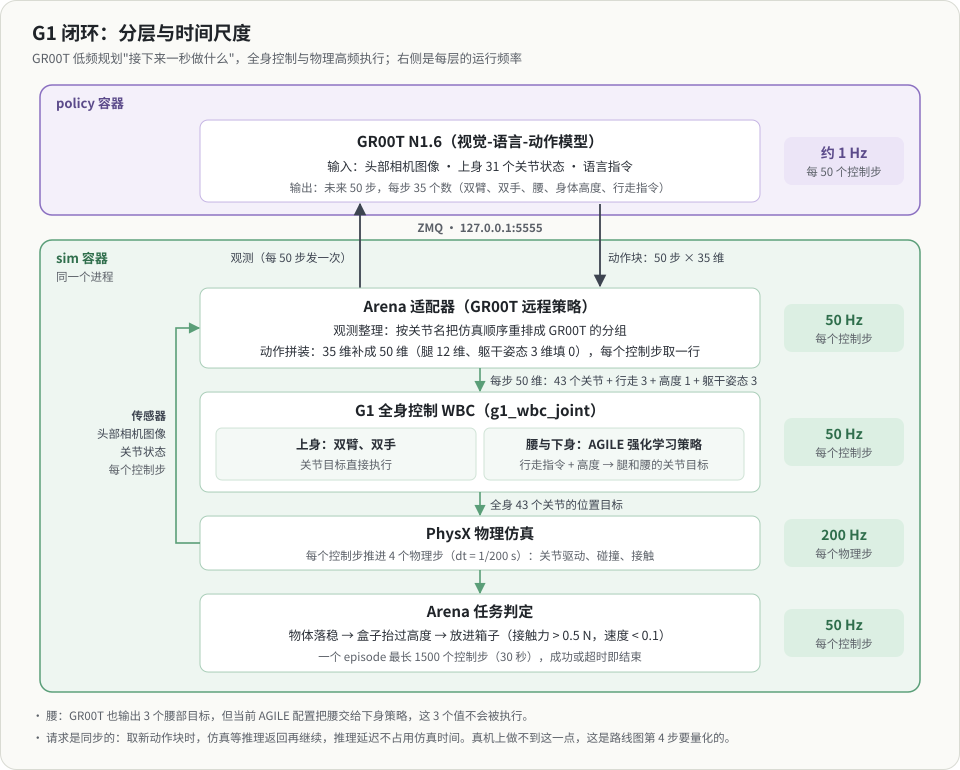
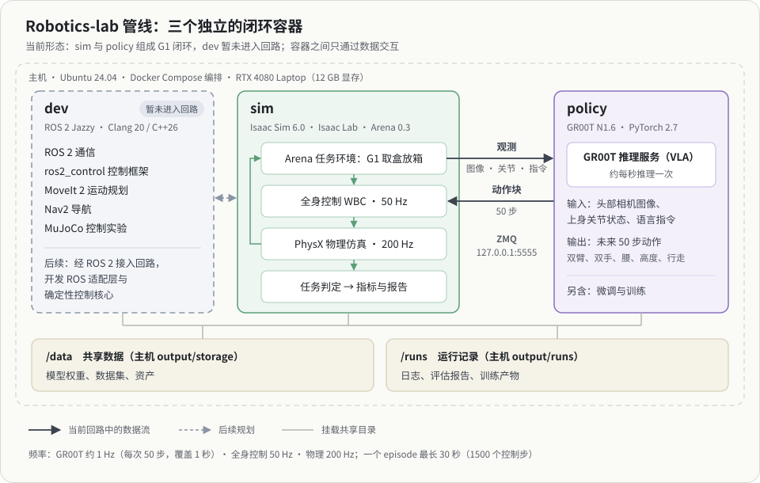

# 入门：机器人、任务与整条管线

> 已归档（2026-10-31）：早期材料，只作历史参考。当前文档见 [文档索引](../README.md)。

2026-10-21。写给对这个项目没有任何概念的读者，也是[学习计划](LEARNING_PLAN.md) Day 0 的第一份材料。读完应该能回答三个问题：这是什么机器人、它要完成什么任务、一次运行从头到尾经过了哪些环节。代码和配置细节留给后面的日程。

## 一、机器人：Unitree G1

G1 是宇树科技（Unitree）的人形机器人。官网给出的主要规格：

| 项 | 规格 |
|---|---|
| 身高、体重 | 约 1.32 m，约 35 kg（含电池） |
| 自由度 | 基础版 23 个；EDU 版 23–43 个，可选三指灵巧手 Dex3-1，以及腰、手腕的附加关节 |
| 灵巧手 Dex3-1 | 每只 7 个主动自由度：拇指 3、食指 2、中指 2 |
| 传感器 | 深度相机、3D 激光雷达 |
| 续航 | 约 2 小时 |

**自由度**是机器人能独立运动的方向数，对 G1 来说就是能独立驱动的关节数。仿真里用的是满配模型 `g1_29dof_with_hand`：身体 29 个自由度，加两只手各 7 个，一共 43 个。

| 部位 | 自由度 | 关节 |
|---|---|---|
| 腿 | 6 × 2 | 髋 3（俯仰、横滚、偏航）、膝 1、踝 2（俯仰、横滚） |
| 腰 | 3 | 偏航、横滚、俯仰 |
| 手臂 | 7 × 2 | 肩 3（俯仰、横滚、偏航）、肘 1、腕 3（横滚、俯仰、偏航） |
| 手 | 7 × 2 | 拇指 3、食指 2、中指 2 |

偏航、横滚、俯仰分别是绕竖直轴、前后轴、左右轴的转动。

在这个 demo 里，机器人只用两类信息感知世界：头部的一个 RGB 相机（480×640 像素），以及自身 43 个关节的角度（称为本体感知）。真机上的深度相机和激光雷达没有用到。

## 二、任务：从货架取盒子，放进箱子

场景是一个仿真仓库（Arena 里叫 Galileo）：仓库里有一个货架，上面放着一个棕色盒子；货架右侧有一张桌子，桌上有一个蓝色的分拣箱。机器人收到一句英文指令：

> Pick up the brown box from the shelf, and place it into the blue bin on the table located at the right of the shelf.

它要自己看、自己决定怎么动：从货架上取下盒子，走到桌边，把盒子放进箱子。这类"边走边操作"的任务叫**移动操作**（loco-manipulation），难点在于走路和手上的动作会互相影响。

一次尝试称为一个 **episode**，最长 30 秒仿真时间。成功要依次满足三个条件：物体落稳、盒子被抬过一定高度、盒子稳稳待在箱子里（与箱子有向上的支撑接触力，且几乎不再运动）。30 秒内没做到就算超时失败。

## 三、整条管线：一次 episode 从头到尾

参与的有三个部分：policy 容器里的 GR00T 大模型、sim 容器里的仿真和控制、以及负责记录的评估程序。

1. **启动**：先在 policy 容器启动 GR00T 推理服务，它在本机的 5555 端口等待请求；再在 sim 容器启动评估程序，它连上推理服务。
2. **重置**：Isaac Sim 搭好仓库、货架、盒子、箱子和 G1，机器人站在起点。
3. **每个控制步**（1/50 秒）重复下面几件事：
   1. 采集观测：头部相机拍一张图，读出 43 个关节的角度。
   2. 需要时向大模型要动作：手上的动作用完了（每 50 步一次，也就是每秒一次），就把图像、上身关节状态和那句指令发给 GR00T，拿回接下来 50 步的动作。
   3. 取出这一步的动作，交给全身控制器（WBC）：手臂和手的目标直接执行；腰和腿交给一个用强化学习训练好的小网络（AGILE），它根据"往哪走、走多快、身体多高"的指令生成迈腿和保持平衡的动作。
   4. 物理仿真推进 4 个物理步（每步 1/200 秒），算出碰撞、接触和关节运动。
   5. 检查任务条件有没有满足。
4. **结束**：三个条件都满足就成功；到 1500 个控制步（30 秒）还没完成就超时。
5. **记录**：结果写成一份 JSON 记录和一份 HTML 报告，放在主机的 `output/runs/arena-g1/evaluation/` 下。

关键在于分层：大模型通用但慢，每秒只"想"一次，决定接下来一秒怎么动；平衡和步态需要快速反应，交给每秒运行 50 次的小网络；物理计算更快更细，每秒 200 步。

## 四、三个容器各做什么

- **sim**：Isaac Sim 物理仿真与渲染、Isaac Lab 环境、Arena 任务与评估，全身控制器也在这里。上面第 2–5 步都发生在 sim 的同一个进程里。
- **policy**：GR00T 推理服务，以及以后的模型微调和训练。它只通过网络端口和 sim 交流，所以也可以搬到云端。
- **dev**：ROS 2、控制与规划工具、C++ / Python 开发。在这个 demo 里还没有参与，以后负责 ROS 接口和确定性控制核心。

三个容器之间只通过数据交互：共享的模型与数据目录、运行记录目录，以及网络端点。详见各容器自己的说明和[容器指南](../CONTAINERS.md)。

## 五、名词表

| 名词 | 意思 |
|---|---|
| 自由度（DoF） | 能独立运动的方向数；对 G1 来说就是能独立驱动的关节数 |
| 本体感知 | 机器人对自身状态的感知，例如关节角度 |
| VLA | 视觉-语言-动作模型：输入图像和语言，输出机器人动作；GR00T 是其中之一 |
| 动作块 | 模型一次输出的一段连续动作，这里是 50 步，覆盖 1 秒 |
| WBC | 全身控制器：把高层指令变成全身关节的目标，同时保持平衡 |
| 控制步 / 物理步 | 控制器每 1/50 秒更新一次动作；物理仿真每 1/200 秒算一步，一个控制步包含 4 个物理步 |
| episode | 从重置到成功或超时的一次完整尝试 |
| 仿真时间 | 仿真世界里的时间，可以比真实时间快或慢 |
| ZMQ | 一种轻量的进程间通信库，sim 通过它向 policy 发请求 |

## 来源

- Unitree G1 规格：Unitree 官网 G1 页面（2026-10-21 查阅）。
- 关节名单与顺序：Arena 固定提交 `8737b4c` 的 `isaaclab_arena_gr00t/embodiments/g1/43dof_joint_space.yaml`。
- 相机、场景、频率与成功条件：同一提交的 `isaaclab_arena/embodiments/g1/g1.py`、`isaaclab_arena_environments/galileo_g1_locomanip_pick_and_place_environment.py` 与任务判定代码；更细的字段见[配置导读](../platform/G1_GR00T_CONFIGS.md)。
