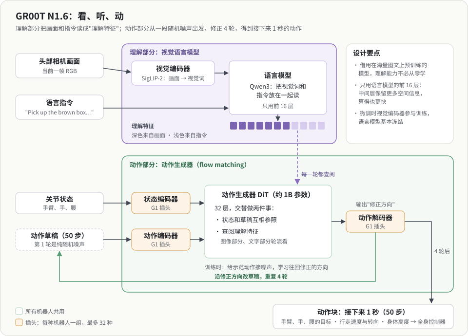

# 平台：G1 基线是怎么设计的

本项目的实验平台是 NVIDIA 于 2026 年 7 月开源的 Isaac Lab-Arena × GR00T N1.6 G1 移动操作 demo。本页说明这个平台在做什么、分成哪几块、每块用了什么神经网络，重点是 VLA（视觉-语言-动作）模型。它只是二次开发的起点；项目自己的目标与计划见 [项目目标](../PROJECT_GOALS.md) 和 [项目计划](../PROJECT_PLAN.md)。参数、代码位置和运行方法见 [操作手册](G1_MANUAL.md)。

## 一、机器人与任务

### 机器人：Unitree G1

G1 是宇树科技（Unitree）的人形机器人。官网给出的主要规格：

| 项 | 规格 |
|---|---|
| 身高、体重 | 约 1.32 m，约 35 kg（含电池） |
| 自由度 | 基础版 23 个；EDU 版 23–43 个，可选三指灵巧手 Dex3-1，以及腰、手腕的附加关节 |
| 灵巧手 Dex3-1 | 每只 7 个主动自由度：拇指 3、食指 2、中指 2 |
| 传感器 | 深度相机、3D 激光雷达 |
| 续航 | 约 2 小时 |

仿真里用的是满配模型 `g1_29dof_with_hand`：身体 29 个自由度，加两只手各 7 个，共 43 个。

| 部位 | 自由度 | 关节 |
|---|---|---|
| 腿 | 6 × 2 | 髋 3（俯仰、横滚、偏航）、膝 1、踝 2（俯仰、横滚） |
| 腰 | 3 | 偏航、横滚、俯仰 |
| 手臂 | 7 × 2 | 肩 3（俯仰、横滚、偏航）、肘 1、腕 3（横滚、俯仰、偏航） |
| 手 | 7 × 2 | 拇指 3、食指 2、中指 2 |

平台里机器人只用两类信息感知世界：头部的一个 RGB 相机（480×640），以及自身关节的角度（本体感知）。真机上的深度相机和激光雷达没有用到。

### 任务：从货架取盒子，放进箱子

场景是一个仿真仓库（Arena 里叫 Galileo）：货架上放着一个棕色盒子，货架右侧的桌上有一个蓝色分拣箱。机器人收到一句英文指令：

> Pick up the brown box from the shelf, and place it into the blue bin on the table located at the right of the shelf.

它要自己看、自己走、自己拿，整个过程没有手写的动作脚本。这类边走边操作的任务叫移动操作（loco-manipulation），难点在于走路和手上的动作会互相影响。

一次尝试称为一个 episode，最长 30 秒仿真时间。成功要依次满足三个条件：物体落稳、盒子被抬过一定高度、盒子稳稳待在箱子里。盒子中途掉落则提前结束，30 秒内没完成算超时。

## 二、整体设计：慢的大脑，快的小脑

人去拿东西时，"去拿那个盒子"是一个慢的、有意识的念头；走路时脚怎么落地、身体怎么保持平衡，则是快的、几乎不用想的反应。这个 demo 按同样的思路分工：

| 角色 | 部件 | 多久做一次决定 | 负责什么 | 怎么学会的 |
|---|---|---|---|---|
| 大脑 | GR00T N1.6（VLA 模型） | 每秒 1 次 | 看图、听指令，决定接下来一秒手怎么动、往哪走 | 模仿人类示范 |
| 小脑 | AGILE（行走策略） | 每秒 50 次 | 把"往前走、蹲低一点"变成两条腿的动作，并且不摔倒 | 在仿真里反复试错（强化学习） |
| 身体与世界 | Isaac Sim | 每秒 200 次 | 计算碰撞、受力和运动，渲染相机画面 | 不学习，是物理引擎 |

为什么要分开？大模型懂图像和语言，但又大又慢；保持平衡需要快速反应，却不需要懂语言。各用所长，再用一个简单的接口把它们接起来：大脑只告诉小脑"走多快、往哪转、身体多高"，手臂和手的动作则由大脑直接给出。

## 三、VLA：一个模型怎样"看、听、动"

### 基本思路

VLA 的出发点是借力。互联网上有海量的图文数据，已经训练出能"看懂图、读懂话"的视觉语言模型（VLM）。VLA 在这样一个模型后面接上一个"动作生成器"，再用机器人的示范数据教它把"理解"变成"动作"。理解能力不必从零学，机器人数据只需要教会它怎么动。GR00T 就是这样一个模型，分成理解和动作两部分。

### 理解部分：视觉语言模型

- **看**：视觉编码器（SigLIP-2）把头部相机画面切成许多小块，每块变成一个向量，可以理解成一个个"视觉词"。
- **读**：语言模型（Qwen3）把视觉词和指令的文字放在一起读，输出一串"理解特征"：画面里有什么、指令要什么、两者怎样对应。
- **一个值得注意的设计**：只用语言模型的前一半多层，后面的层直接丢掉。语言模型最后几层专门为"说出下一个字"服务；中间层还保留着更多空间和物体的信息，对动作更有用，算得也更快。

### 动作部分：从噪声里"画"出动作

动作生成器是一个约 1B 参数的 Transformer（论文里叫 DiT，扩散 Transformer）。它不是一步"算出"动作，而是：

1. 先随机生成一段乱七八糟的"动作草稿"（纯噪声），长度是接下来 1 秒的 50 个控制步；
2. 每一轮，模型看着草稿、机器人自己的关节状态，并反复查阅理解特征（交替地看图像和文字），判断"草稿应该往哪个方向改"；
3. 按这个方向修改草稿，重复 4 轮，得到最终的动作块。

这和 AI 画图从一片噪点逐渐变清晰是同一个原理，训练方法叫 flow matching：拿一段真实的示范动作，掺进不同比例的噪声，让模型学会"往回修正的方向"。

**为什么要从噪声生成，而不是直接输出一个答案？** 同一个场景常常有好几种正确做法，比如从左边绕过去或从右边绕过去。直接输出一个答案的模型会把它们平均成一个哪边都不是的错误动作；生成式模型能挑出其中一种，完整而连贯地做下去。

**为什么一次输出一整秒（动作块）？** 动作更连贯，大模型也不必每 1/50 秒都算一次。代价是这一秒里它不再看新的画面，相当于闭着眼睛执行。

### 适配不同机器人：换"插头"

不同机器人的关节数量和含义都不一样。GR00T 的做法是：中间的理解部分和动作生成器所有机器人共用；"读入关节状态"和"输出动作"这两头，每种机器人各用一组小网络，像插头一样。模型预留了 32 个插槽，这个任务用的是"新机器人"插槽。这就是"通用基础模型 + 具体机器人适配"的思路。

### 它是怎么训练出来的

都由 NVIDIA 完成，我们直接下载权重：

1. **预训练**：按 GR00T 系列论文的说明，在大量真实机器人数据、人类视频和仿真数据上学习通用能力，得到 GR00T N1.6 基础模型。
2. **采集示范**：人戴 VR 头显，在仿真里遥操作 G1 完成这个任务（摇杆控制走路和下蹲，手柄控制双手），录下少量示范。
3. **扩增数据**：Isaac Lab Mimic 把示范切成子任务（如走过去、抓起、放下），变换物体位置并相应调整轨迹，自动扩增出更多示范（上游教程生成 100 条）。
4. **微调**：用扩增后的示范微调基础模型。语言模型大部分冻结，只放开最后几层；视觉编码器、动作生成器和 G1 的插头全部训练。

这个分工值得记住：大部分"常识"来自预训练，任务本身只需要百条量级的示范。

## 四、AGILE：在仿真里练出来的走路

AGILE 是一个小得多的网络，只做一件事：按指令走路且不摔倒。

- **输入**：行走指令（前后速度、左右速度、转向速度、身体高度）和全身关节状态等本体感知；**输出**：12 个腿部关节的目标角度；每秒 50 次。
- **怎么练**：强化学习。在 Isaac Lab 里让大量机器人并行练习，按"跟上指令、不摔倒、动作平稳省力"打分，让它们反复尝试，分数高的行为被强化。
- **老师和学生**：先训练一个能看到仿真里完整真值信息的"老师"，再训练一个只用真实机器人也拿得到的传感信息的"学生"去模仿老师。学生带有记忆（LSTM），能从最近一段历史里推测看不到的信息，比如脚下是否打滑。实际运行的是学生。
- 它不看图也不懂语言。腰部在这个 demo 里被锁住，AGILE 只管两条腿。

## 五、仿真、任务和评估

三层软件，自下而上：

- **Isaac Sim**：物理引擎加渲染器。相机画面是渲染出来的，所以模型"看到"的就是仿真画面。
- **Isaac Lab**：把机器人、场景和控制器组织成可以训练、可以采数据的"环境"。AGILE 的强化学习和 Mimic 的数据扩增都在这一层。
- **Isaac Lab-Arena**：在 Lab 之上搭"考场"：场景、物体、成功条件、批量评估和报告，还能改变光照、相机等条件测试鲁棒性。

GR00T 跑在单独的进程（policy 容器）里，通过网络端口和仿真通信，所以模型也可以放到云端 GPU 上。三个容器的分工见 [容器指南](../CONTAINERS.md)。

## 六、这个设计的取舍

**好处**：端到端，从像素和文字直接到动作，不需要手写抓取规划或导航地图；换任务主要靠换数据，而不是改代码。

**代价**，也是本项目二次开发的出发点（见 [项目目标](../PROJECT_GOALS.md#与平台的差距)）：

- **决策和执行缠在一起**：同一个模型既决定"做什么"，又决定"每根手指怎么动"，中间没有可以审查的环节。
- **下身是学习型黑盒**：平衡由 AGILE 保证，没有可验证的安全边界。
- **仿真会等模型**：推理时仿真暂停，现实世界不会等。
- **一秒内闭眼执行**：动作块执行期间不看新画面。

## 名词表

| 名词 | 意思 |
|---|---|
| 自由度（DoF） | 能独立运动的方向数；对 G1 来说就是能独立驱动的关节数 |
| 本体感知 | 机器人对自身状态的感知，例如关节角度 |
| VLA | 视觉-语言-动作模型：输入图像和语言，输出机器人动作 |
| 动作块 | 模型一次输出的一段连续动作，这里是 50 步，覆盖 1 秒 |
| WBC | 全身控制器：把高层指令变成全身关节的目标，同时保持平衡 |
| 控制步 / 物理步 | 控制器每 1/50 秒更新一次动作；物理仿真每 1/200 秒算一步 |
| episode | 从重置到成功、失败或超时的一次完整尝试 |
| ZMQ | 一种轻量的进程间通信库，sim 通过它向 policy 发请求 |

## 想深入时的关键词

- VLA 整体：GR00T N1 论文（arXiv 2503.14734）；π0（Physical Intelligence，flow matching VLA 的代表作）；OpenVLA
- 视觉语言模型：SigLIP、Eagle
- 生成式动作：Diffusion Policy；Flow Matching / Rectified Flow
- 动作块：ACT（Action Chunking with Transformers）
- 人形行走的强化学习：teacher-student 蒸馏、Isaac Lab 运动控制
- 示范扩增：MimicGen

## 来源

- Unitree G1 规格：Unitree 官网 G1 页面（2026-10-21 查阅）。
- 结构与参数：Arena 固定提交 `8737b4c`、GR00T 固定提交 `e29d8fc` 的源码与权重配置，逐项出处见 [操作手册的细节索引](G1_MANUAL.md#细节索引)。
